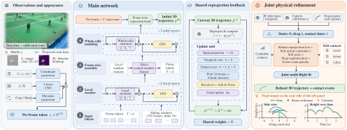

# FeatherTrace3D

**Monocular Trajectory Reconstruction with Local Appearance, Rally-Level Modeling, and Physical Refinement**

[Project page](https://zdc852636-code.github.io/feathertrace3d-project-page/) · [Research video](https://zdc852636-code.github.io/feathertrace3d-project-page/#films)

Start with the method overview and the 3:05 supplementary film. The four contributions cover neural prediction, joint physical refinement, depth precision and a hand-held benchmark. Three phone replays compare the reconstructed flight with a stereo reference. Two tournament excerpts show the fitted flight from a broadcast camera.
